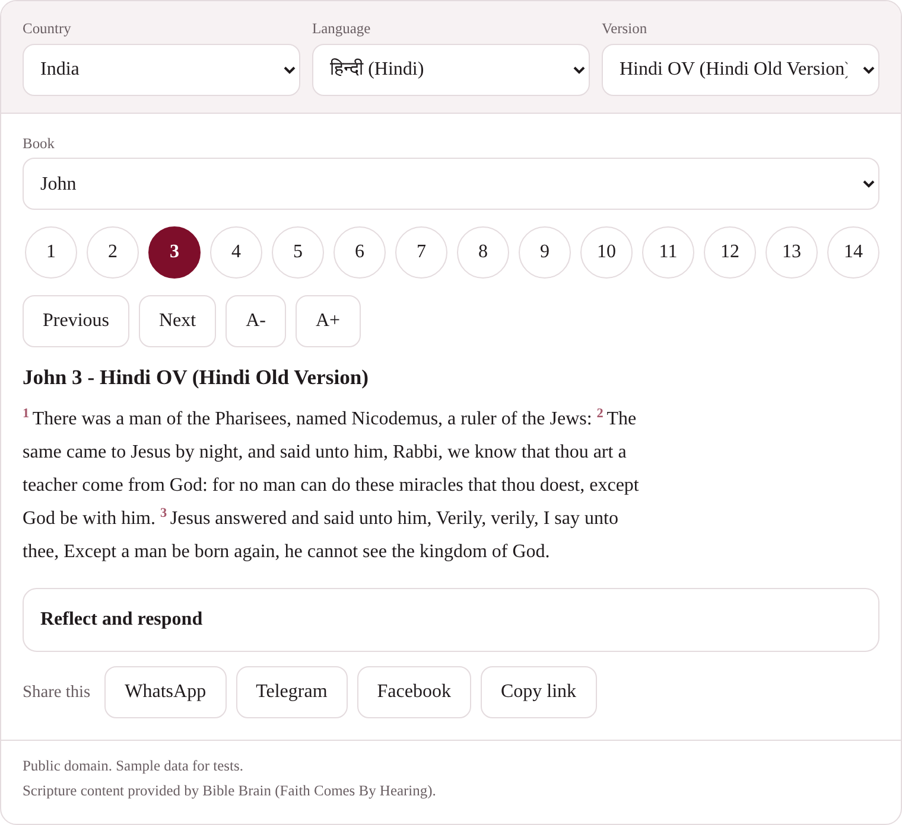
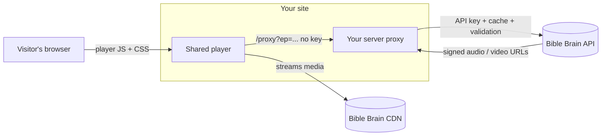

# Bible Brain Toolkit

[](https://github.com/shalomdesigns2dio/bible-brain-toolkit/actions/workflows/ci.yml)
[](LICENSE)


**The Bible Brain Toolkit is a free, open-source set of tools for putting Bible Brain audio, video and text on websites: a WordPress plugin, a Drupal module, a Joomla plugin, an HTML5 embed with a small proxy, and a desktop downloader.**

Put audio, video and text Scripture on any website in minutes, and let visitors share it where they already gather. The toolkit brings the
[Bible Brain](https://4.dbt.io/) API (from Faith Comes By Hearing) to the places where ministries actually publish: WordPress, Drupal, Joomla,
plain HTML pages, site builders, and your own desktop. One shared player, one small server-side proxy, and thin wrappers for each platform
keep everything consistent and easy to maintain.

> **Unofficial project.** Developed by **[Shalom Design S2dio (SDS)](https://www.shalomdesigns2dio.com/)**, with the help of AI tools (see [AI assistance](#ai-assistance)). This toolkit is community-built and is not published, endorsed or supported by Faith Comes By Hearing.
> Scripture content is provided by [Bible Brain](https://www.faithcomesbyhearing.com/audio-bible-resources/bible-brain), a project of [Faith Comes By Hearing](https://www.faithcomesbyhearing.com/).
> You need your own free API key, and you remain responsible for following the licence of every Bible version you display. See [NOTICE.md](NOTICE.md).

**[Try the live demo](https://www.shalomdesigns2dio.com/bible-brain-toolkit/)** - the players run in your browser on sample data, with no key needed.
You can also point the demo at your own proxy to see your own content.



*Screenshots in this repository use a local mock of the API with public-domain (KJV) sample text. They are not live Bible Brain data.*

---

## Why this toolkit exists

Many of the people who most need Scripture in their own language prefer to **listen and watch** rather than read.
The toolkit is therefore **audio-first and video-ready**, with text as a companion rather than the centre.

- **Audio and video lead.** The audio player and the video player are first-class. The text reader can play the audio
  for the same chapter while the reader follows along.
- **Phones first.** Large touch targets, light pages, and no framework to download.
- **Made to be shared.** Every player produces a link that opens at the same chapter, with one-tap sharing to WhatsApp,
  Telegram and Facebook, plus a copy-link button.
- **Built for response, not only consumption.** A short "Reflect and respond" panel invites people to retell the passage
  in their own words and decide what they will do. Ministries can write their own questions.
- **Measurable.** Events flow into Google Tag Manager, GA4 or Matomo so teams can learn what is helping people engage.


## What is inside

| Package | Folder | What it is | Needs |
|---|---|---|---|
| **WordPress plugin** | [`packages/wordpress`](packages/wordpress/bible-brain-players) | Shortcodes `[bb_reader]` `[bb_audio]` `[bb_video]`, settings page, built-in REST proxy | WordPress 5.8+, PHP 7.4+ |
| **Drupal module** | [`packages/drupal`](packages/drupal/bible_brain) | A "Bible Brain player" block, settings form, built-in proxy route | Drupal 10.2+ or 11, PHP 8.1+ |
| **Joomla plugin** | [`packages/joomla`](packages/joomla/plg_system_biblebrain) | `{bbp audio ...}` tags anywhere in content, built-in proxy | Joomla 4.4 or 5 (written to also suit 6, not yet tried), PHP 8.1+ |
| **HTML5 embed** | [`packages/html5-embed`](packages/html5-embed) | A few lines of HTML for any website, plus a standalone PHP proxy | Any PHP 7.4+ host |
| **Downloader** | [`packages/downloader`](packages/downloader) | Desktop app and command line tool to save text and audio as ZIP files | Python 3.8+ |
| **Shared player** | [`shared`](shared) | The single source of the player code, styles, PHP core and translations | - |

## Features

### Players (all platforms)
- **Bible reader** with book and chapter navigation, adjustable text size, verse numbers, and optional "listen while you read".
- **Audio player** with play, pause, 15-second skip, speed control, a seek bar, and automatic next chapter.
- **Video player** for Bible Brain video filesets (HLS streaming through hls.js) with a clip list per book and automatic next clip.
- **Country, language and version selector** so visitors can choose, or lock a player to one version with `selector="no"`.
- **Verse highlighting** while listening and reading, when Bible Brain provides timing data for the recording.
- **Right-to-left support** (Urdu and other RTL languages) and a mobile-friendly layout.
- **Light, dark or automatic theme** and a configurable accent colour.
- **Accessible controls** built from standard buttons and form fields, labelled for screen readers, with a visible focus outline.

### Engagement and sharing
- **Deep links** that reopen the same country, version, book and chapter.
- **One-tap sharing** to WhatsApp, Telegram and Facebook, plus copy link.
- **Reflection prompts** that you can rewrite for your own audience and language.
- **Analytics events** (`bbp_play`, `bbp_complete`, `bbp_share`, ...) for GTM, GA4 and Matomo. See [docs/analytics.md](docs/analytics.md).

### Languages of the interface
Draft translations are bundled for **Hindi, Bengali, Nepali, Sinhala, Urdu and Malayalam**. The player picks the language
from the page (`<html lang="...">`) automatically. These are drafts and **need review by native speakers** - see
[docs/localization.md](docs/localization.md). Contributions are very welcome.

### Safe by design
- **Your API key stays on the server.** Browsers talk only to your own proxy, never to Bible Brain directly with your key.
- **Strict input checking** on every proxy request, response caching, a per-visitor rate limit, optional country allow-list
  and an origin allow-list so other websites cannot use your proxy. See [SECURITY.md](SECURITY.md).

### Downloader
- A desktop window (Tkinter, no extra packages) to browse by country and language and save a fileset as a ZIP.
- A **command line mode** for scripting, for example `python main.py --list-countries`.
- Cancel at any time, retry on network errors, and a README with the copyright line inside every ZIP.

## Quick start

Request a **free API key** at <https://4.dbt.io/api_key/request>, then choose your platform.

### WordPress
1. Download `bible-brain-wordpress-<version>.zip` from the [Releases](../../releases) page.
2. Plugins > Add New > Upload Plugin, then activate.
3. Settings > Bible Brain Players: paste your key and choose default versions.
4. Add a shortcode to any page:

```text
[bb_audio country="IN" language="hin" bible="HINDOV"]
[bb_reader country="IN" bible="HINDOV" selector="no"]
[bb_video country="IN" language="hin" title="Watch the Gospel"]
```

### Drupal
Copy `bible_brain` to `modules/custom/`, enable it, open `/admin/config/media/bible-brain`, paste the key, then place the
**Bible Brain player** block. Details: [packages/drupal/bible_brain/README.md](packages/drupal/bible_brain/README.md).

### Joomla
Install `plg_system_biblebrain-joomla-<version>.zip`, enable **System - Bible Brain Players**, paste the key, then write
`{bbp audio country="IN" language="hin" bible="HINDOV"}` in any article.
Details: [packages/joomla/plg_system_biblebrain/README.md](packages/joomla/plg_system_biblebrain/README.md).

### Any website (HTML5)
Upload `packages/html5-embed` to a PHP host, copy `config.sample.php` to `config.php`, add your key, open `generator.html`,
choose a version and paste the generated code:

```html
<link rel="stylesheet" href="https://example.org/bible/bible-brain-players.css">
<div class="bbp-audio" data-rest="https://example.org/bible/bbp-proxy.php?ep="
     data-country="IN" data-language="hin" data-bible="HINDOV"></div>
<script src="https://example.org/bible/bible-brain-players.js" defer></script>
```

For Wix, Blogger, Squarespace or Google Sites, use `iframe.html`. Details: [packages/html5-embed/README.md](packages/html5-embed/README.md).

### Downloader
```bash
python packages/downloader/main.py                      # desktop window
export BIBLE_BRAIN_KEY=your-key
python packages/downloader/main.py --list-countries      # command line
python packages/downloader/main.py --list-filesets --country IN --language hin
python packages/downloader/main.py --fileset HINDOVN2DA --type audio_drama --out ./downloads
```

More walk-throughs: [docs/getting-started.md](docs/getting-started.md).

## How it fits together



Every package contains the same player and the same PHP core. The repository keeps **one copy in [`shared/`](shared)** and a
script copies it into each package, so a fix is made once. See [docs/architecture.md](docs/architecture.md).

## Configuration at a glance

The same options work everywhere; only the syntax differs.

| Option | Meaning | Example |
|---|---|---|
| `country` | Two-letter country code | `IN` |
| `language` | Language code | `hin` |
| `bible` | Bible version abbreviation | `HINDOV` |
| `fileset` | A specific fileset ID (optional) | `HINDOVN2DA` |
| `book`, `chapter` | Where to start | `JHN`, `3` |
| `selector` | `no` locks the player to one version | `no` |
| `share`, `reflect`, `listen` | Turn the share bar, reflection panel or listen-while-reading on or off | `no` |
| `theme`, `accent` | `light`, `dark` or `auto`, and a colour | `#7E0E2A` |
| `title` | A heading above the player | `Listen` |
| `lang` | Interface language (defaults to the page language) | `hi` |

Full reference with the WordPress, Joomla, Drupal and HTML5 syntax: [docs/reference.md](docs/reference.md).

## Development

```bash
git clone https://github.com/shalomdesigns2dio/bible-brain-toolkit.git
cd bible-brain-toolkit
python scripts/sync_shared.py        # after editing anything in shared/
python scripts/build_locales.py      # after editing shared/i18n/*.json
python scripts/test_all.py           # every check and test
python scripts/build.py              # builds installable ZIP files into dist/
```

`test_all.py` needs Python 3.8+, PHP 7.4+ and Node. Add `pip install -r tests/requirements.txt` and
`python -m playwright install chromium` for the browser tests, or run `python scripts/test_all.py --fast` to skip them.
See [CONTRIBUTING.md](CONTRIBUTING.md).

### Honest testing status

| Area | How it is tested |
|---|---|
| Player JavaScript | Automated browser tests in Chromium (reader, audio, video, selectors, sharing, analytics events, languages, RTL, phone width) |
| PHP core and proxy | Automated tests running the real `bbp-proxy.php` under PHP against a mock Bible Brain server (validation, caching, key secrecy, origin rules) |
| Downloader | Automated tests for the logic, ZIP building, cancel and command line mode against the mock server |
| WordPress, Drupal, Joomla wrappers | Syntax-checked and share the tested core, **but not yet run inside the real CMS**. Please report anything you find. |
| Live Bible Brain API | The mock follows the documented v4 shape. **Run against the live service by you for the first time**; some endpoints (for example the file-list route used by the downloader) may need small adjustments |
| Downloader desktop window | The window code has not yet been viewed on a real display. The command line mode is tested |
| Translations | Draft quality, **awaiting native-speaker review** |

Feedback from real sites is the fastest way to improve all of these.

## Demo website and directory listings

- **Website at Shalom Design S2dio.** The demo and the code generator are hosted at <https://www.shalomdesigns2dio.com/bible-brain-toolkit/>.
  `python scripts/build_website.py` builds the upload-ready folder and ZIP in `dist/`. See [docs/website-hosting.md](docs/website-hosting.md).
- **Demo website.** The folder `site/` is a static website that runs the real players on public-domain sample text and generated
  test audio and video (clearly labelled as not Scripture). `.github/workflows/pages.yml` can also publish it with GitHub Pages (optional mirror):
  open **Settings > Pages**, set **Source** to **GitHub Actions**, then push to `main`. Build it locally with
  `python scripts/build_site.py` and open `site/index.html` through any static web server. Regenerate the sample media with
  `python scripts/build_demo_media.py` (needs ffmpeg).
- **WordPress.org, Drupal.org and the Joomla Extensions Directory.** Step-by-step guides, copy-paste descriptions and a
  packaging script are in [docs/submission/](docs/submission/README.md).

## Developer and AI assistance

**Developer and host:** [Shalom Design S2dio (SDS)](https://www.shalomdesigns2dio.com/), in partnership with the original project author. The toolkit is hosted at <https://www.shalomdesigns2dio.com/bible-brain-toolkit/> and the source code is at <https://github.com/shalomdesigns2dio/bible-brain-toolkit>.

This is an unofficial community project. It is not published, endorsed or supported by Faith Comes By Hearing.

<a id="ai-assistance"></a>
### AI assistance
This toolkit was built with AI assistance, sometimes called "vibe coding": the developer set the goals, made the design decisions,
and directed and checked the work, while the AI wrote most of the code, tests and documentation.

- **Tool used:** Claude (Anthropic), through Claude Code. Commits made with its help carry a `Co-Authored-By: Claude` line.
- **Human responsibility:** the developer is accountable for what is published here. AI-written code can contain mistakes, so
  review it, and test it on a staging site, before you rely on it.
- **What was checked:** the repository has automated tests (see [CONTRIBUTING.md](CONTRIBUTING.md)) that cover the proxy and the players in a
  real browser. They run against a local mock of the API. The CMS plugins have not yet been run inside real WordPress, Drupal and Joomla sites.
- **Contributions:** you may use AI tools in pull requests. Please say so in the description, and make sure you understand and have tested what you submit.

## Credits
Scripture text, audio and video are provided by [Bible Brain](https://www.faithcomesbyhearing.com/audio-bible-resources/bible-brain), a project of [Faith Comes By Hearing](https://www.faithcomesbyhearing.com/), under the licence of each Bible version.
Video streaming uses [hls.js](https://github.com/video-dev/hls.js) (Apache-2.0).

## Roadmap

Ideas gathered so far (progressive web app, WhatsApp and Telegram bots, QR-code and SMS sharing, offline packs, a
Gutenberg block, and more) are listed in [docs/roadmap.md](docs/roadmap.md). Suggestions are welcome as issues.

## About and useful links

| | |
|---|---|
| [Bible Brain](https://www.faithcomesbyhearing.com/audio-bible-resources/bible-brain) | The content service behind the players |
| [Developer documentation](https://www.faithcomesbyhearing.com/bible-brain/developer-documentation) | Guides for developers |
| [API reference](https://www.faithcomesbyhearing.com/bible-brain/api-reference) | Every endpoint |
| [Request a free API key](https://4.dbt.io/api_key/request) | You need your own key |
| [Available content](https://www.faithcomesbyhearing.com/bible-brain-available-content) | Languages and versions |
| [License](https://www.faithcomesbyhearing.com/bible-brain/license), [Terms](https://www.faithcomesbyhearing.com/bible-brain/terms-conditions), [Copyright policy](https://www.faithcomesbyhearing.com/copyright-policy) | Read before you publish |

More in [docs/about.md](docs/about.md).

## Contributing

Translators, developers, designers and ministry practitioners are all welcome. Please read [CONTRIBUTING.md](CONTRIBUTING.md)
and the [Code of Conduct](CODE_OF_CONDUCT.md). Security concerns: [SECURITY.md](SECURITY.md).

## Licence and acknowledgements

Released under the **GNU General Public Licence, version 2 or later** ([LICENSE](LICENSE)), the same family as WordPress,
Drupal and Joomla.

Scripture text, audio and video are provided by **Bible Brain (Faith Comes By Hearing)** and remain subject to the licence
of each Bible version and to the Bible Brain terms of service. This toolkit contains no Scripture content of its own.
The video player uses [hls.js](https://github.com/video-dev/hls.js) (Apache-2.0), loaded from a public CDN by default or
from your own server if you prefer.
