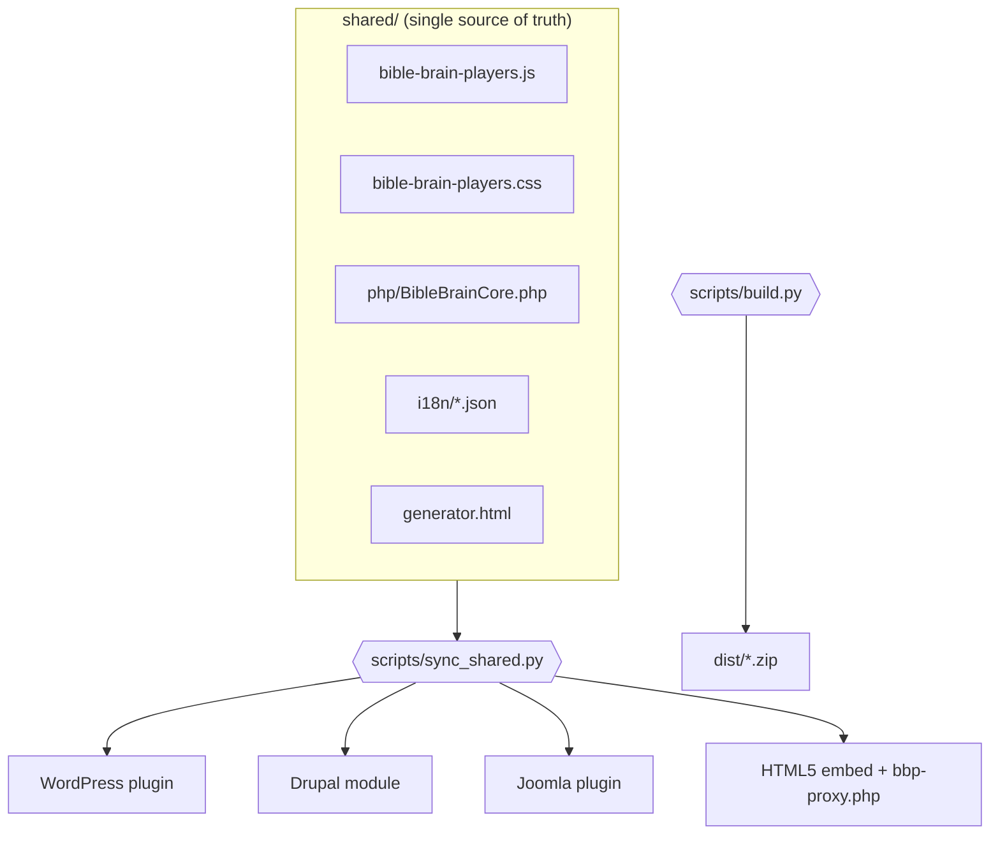

# Architecture

## Goals
- Keep the **API key on the server**.
- Write the player **once** and use it everywhere.
- Keep each platform wrapper **thin**, so that fixes land in one place.
- Work well on **slow phones and networks**: no framework, small files, lazy loading.

## Pieces

- `shared/bible-brain-players.js` is plain JavaScript (no build step for the player itself). Translations from `shared/i18n`
  are baked between `BBP_LOCALES_START` and `BBP_LOCALES_END` markers by `scripts/build_locales.py`.
- `shared/php/BibleBrainCore.php` (namespace `BibleBrain`) holds everything that talks to Bible Brain: catalogue building,
  input validation, text, audio, video and timestamp calls, caching hooks and rate limiting.
- Each CMS wrapper provides only the CMS-specific parts: settings, a route that calls `Core::handle()`, and the tag, shortcode
  or block that outputs `
`.
- `scripts/sync_shared.py` copies the shared files into every package. `--check` fails if a copy differs, which CI runs.

## Request flow

1. The page loads `bible-brain-players.js` and finds `.bbp-reader`, `.bbp-audio`, `.bbp-video` or `.bbp[data-bbp]` elements.
2. The player calls **your** proxy: `GET <rest>catalog?country=IN&media=audio` (CMS) or `bbp-proxy.php?ep=catalog&...` (standalone).
3. The proxy validates the input, adds the key, calls `https://4.dbt.io/api`, trims the answer to what the player needs, caches it and replies.
4. The player streams audio or video directly from the signed CDN links the proxy returned. Media does not pass through your server.

### Proxy endpoints

| `ep` | Parameters | Returns |
|---|---|---|
| `status` | - | `{ok, key_set, php}` (standalone proxy only) |
| `countries` | - | `{countries:[{code,name}]}` |
| `catalog` | `country`, `media` = `text` / `audio` / `video` | `{languages:[{id,name,versions:[{abbr,name,filesets:[...]}]}]}` |
| `books` | `fileset`, `type`, `asset`, `bible`, `size` | `{books:[{id,name,chapters:[...]}]}` |
| `text` | `fileset`, `book`, `chapter`, `type` = `text_plain` / `text_format` | `{book_name, chapter, verses:[{n,text}]}` |
| `audio` | `fileset`, `book`, `chapter`, `type`, `asset` | `{urls:[...]}` |
| `timestamps` | `fileset`, `book`, `chapter` | `{times:[{v,t}]}` |
| `video` | `fileset`, `asset` | `{clips:[{url,thumb,title,book,book_name,chapter,vs,ve,duration}]}` |
| `copyright` | `bible` | `{copyright}` |

Errors are JSON: `{"code":"bbp_error","message":"..."}` with an HTTP status of 400 (bad input or no key), 404 (unknown endpoint),
429 (rate limit) or a status from upstream.

### Where the proxy lives

| Platform | Proxy address |
|---|---|
| WordPress | `https://site/wp-json/bible-brain-players/v1/<endpoint>` |
| Drupal | `https://site/bible-brain/api/<endpoint>` |
| Joomla | `https://site/index.php?bbapi=<endpoint>` |
| Standalone | `https://host/bible/bbp-proxy.php?ep=<endpoint>` |

## One proxy, many sites

Any of the proxies can serve players on other websites, because the player only needs a `data-rest` address. Set the allowed
origins (standalone: `allowed_origins` in `config.php` or `BIBLE_BRAIN_ALLOWED_ORIGINS`) to the sites you trust, so strangers
cannot spend your quota.

## Caching

Catalogue and text responses are cached for `cache_hours` (default 12, maximum 168). Signed audio and video links are cached for
only 5 minutes, and verse timings for a day. WordPress uses transients, Drupal its cache API, Joomla a file cache in its cache
folder, and the standalone proxy a file cache in `cache/`.

## Why the browser never sees the key

The key is read on the server (`config.php`, an environment variable, or the CMS settings). Responses never include it, and the
automated tests check that the key appears in no response body, header or browser request.

## Downloader

`packages/downloader/main.py` is a separate stdlib-only program. It talks to the API directly with the user's own key, because
it runs on the user's own computer.

- `BBApi` - HTTP with retries and paging
- `ZipJob` - chooses a strategy: list downloadable files, or crawl a text fileset chapter by chapter; writes to `.part`, then renames
- `App` - the Tkinter window; all work runs in a thread and reports through a queue
- `cli()` - the command line mode
